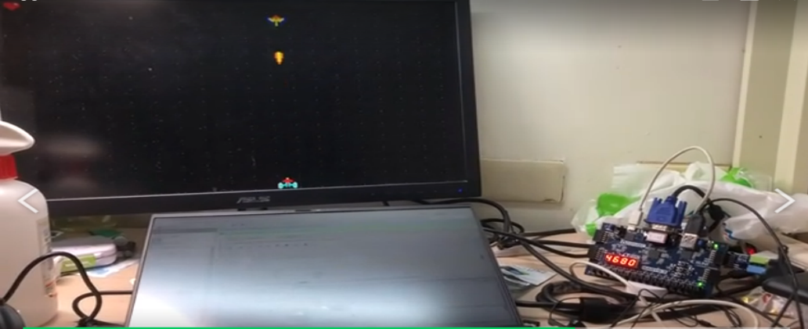
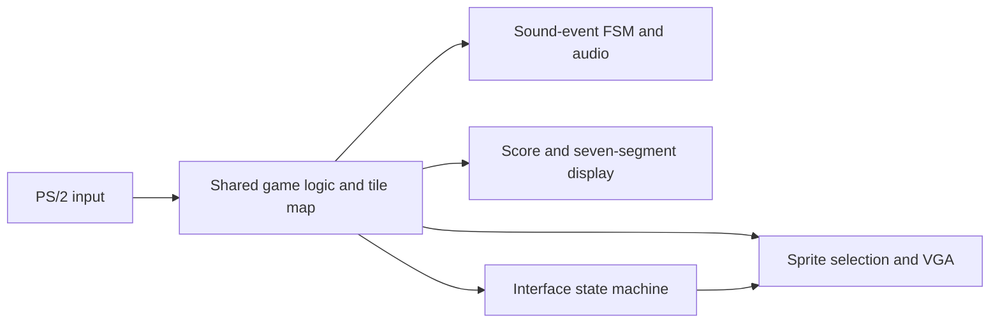
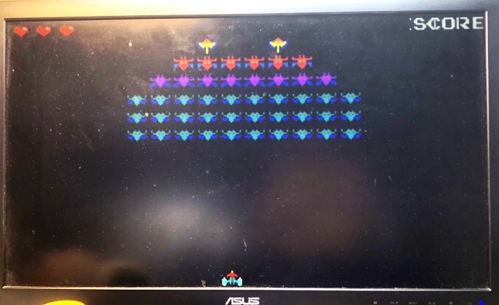
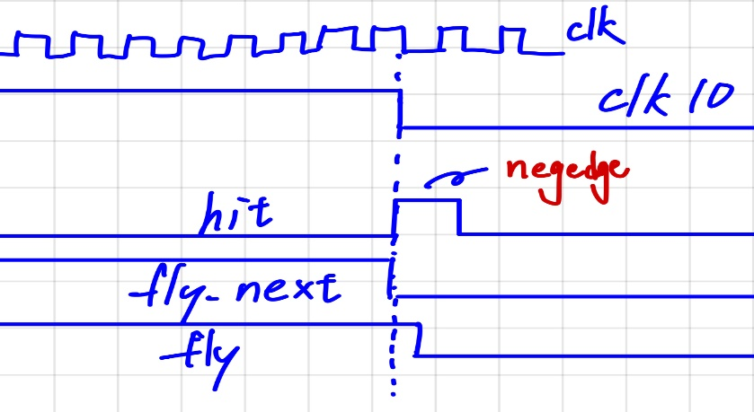

# FPGA Galaxian

**A two-person Verilog arcade-game project with VGA graphics, PS/2 controls, sound effects, and score display.**

The game represents a 640×480 display as a **20×15 grid of 32×32-pixel tiles**. Grid contents drive sprite selection, while game state machines manage player movement, a bullet, falling bombs, health, and win/lose transitions. The archived Vivado project targets `xc7a35tcpg236-1`.

## My contribution

The original report explicitly divides the work:

| Contributor | Recorded responsibilities |
|---|---|
| Hsiang-Yu (Rich) Kung / 孔祥有 | Keyboard, sound modules, color-block test display, report drawings and sections outside game design. |
| 葉濬誠 | Sprite/VGA modules, scoring, interface transitions and the game-design report section. |
| Both | Core game module. |

Keyboard/PS2, display and audio helper modules reuse or adapt course examples; the report also cites [FPGA4fun Musicbox](https://www.fpga4fun.com/MusicBox.html) for the siren-like sound pattern. The repository preserves that context.

## What the system does

| Input / output | Behavior |
|---|---|
| PS/2 keyboard | Left/right movement, Space to shoot, Enter to start, R to return from the ending screen. |
| VGA | Tile/sprite gameplay and start, game-over and stage-clear screens. |
| Audio | Background tone plus shooting and hit effects; switch-controlled mute. |
| Seven-segment display | Score during play and final score at the end. |
| LEDs / button | Game/health indication and hardware reset. |

## Design lesson: timing and shared state

The report documents collision cases in which more than the intended enemy disappeared. The team investigated the interaction between bullet movement, hit events and tile-map updates, recorded bullet coordinates, and made map changes edge-triggered. The report also describes clearing transient tile states before redrawing moving objects to address visual trails.

These are the team's original design/debugging observations. The images are extracted from the existing report; no new hardware demonstration or timing measurement was made for this repository.

## Archive

- [Verilog modules](archive/final_project.srcs/sources_1/new)
- [Pin constraints](archive/final_project.srcs/constrs_1/new/final_project.xdc)
- [Original IP configurations](archive/final_project.srcs/sources_1/ip)
- [Sprite images and COE initialization data](archive/picture)
- [Source and module index](docs/source-index.md)

This is a source-focused archive from the submitted project. Generated synthesis outputs, caches and the compiled bitstream are omitted. Original source, constraints, IP configuration and sprite files are preserved unchanged.
